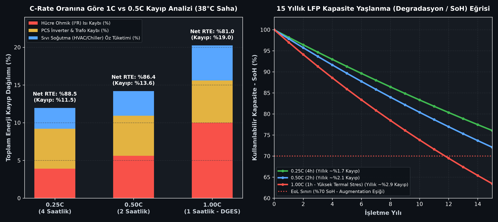

# ⚡ Grid-Scale BESS Techno-Economic, C-Rate Loss & Market Arbitrage Model
> **Case Study:** Utility-Scale Containerized $\text{LiFePO}_4$ (LFP) Storage (1C vs 0.5C vs 0.25C) in the Turkish Electricity Market (EPİAŞ Day-Ahead/Intraday & TEİAŞ Ancillary Services)

[](https://www.python.org/downloads/)
[](LICENSE)
[]()

---

## 📌 Project Overview
With EPDK's regulation on storage-integrated renewable energy plants (DGES / DRES) in Turkey, **Battery Energy Storage Systems (BESS)** have transitioned into a multi-gigawatt grid infrastructure priority.

This repository provides an open-source, physics-informed techno-economic model for utility-scale containerized LFP energy storage operating under **EPİAŞ Day-Ahead Market (PTF)**, **Intraday Market (GİP)**, and **TEİAŞ Ancillary Services (PFC/SFC)**.

### ❓ Core Engineering & Financial Bottlenecks Modeled
1. **Single-Cycle vs. Dual-Cycle + Ancillary Stacking:** Naive single-cycle arbitrage yields an unfeasible **~18.0-year payback** due to round-trip efficiency (RTE) losses and CAPEX. Combining **Dual-Cycle Dispatch** with **TEİAŞ Primary Frequency Control (PFC)** reduces payback to **~5.7 years**.
2. **1C vs. 0.5C / 0.25C Thermal ($I^2R$) & HVAC Chiller Losses:** Under Turkey's 1:1 storage-to-license regulation (1-hour / **1C** discharge), current doubles compared to 0.5C, quadrupling internal ohmic heating ($P_{\text{loss}} = I^2 R_{\text{int}}$). In hot climates (e.g., Southeast Anatolia / Şanlıurfa at $38^\circ\text{C}–45^\circ\text{C}$), liquid-cooling chiller auxiliary loads surge, dropping net AC-to-AC RTE from **86.4% (0.5C)** down to **81.0% (1.0C)** and accelerating annual State of Health (SoH) degradation.

---

## 🔋 Technical & Architectural Specifications

| Component / Parameter | Specification | Standard / Engineering Benchmark |
| :--- | :--- | :--- |
| **Cell Chemistry** | Lithium Iron Phosphate ($\text{LiFePO}_4$ - LFP) | CATL EnerC / BYD MC Cube utility container standard |
| **Reference Block Capacity** | **1,000 kWh (1 MWh)** *(Scalable to 100–600 MWh)* | 20-foot outdoor liquid-cooled containerized enclosure |
| **C-Rate Configurations** | **1.0C (1h), 0.5C (2h), 0.25C (4h)** | EPDK 1:1 DGES/DRES standard (1C) vs. Energy shifting (0.5C/0.25C) |
| **Depth of Discharge (DoD)** | **90%** (900 kWh usable per MWh) | Preserves cycle life to 6,000+ cycles |
| **Round-Trip Efficiency (RTE)** | **81.0% (1.0C) – 86.4% (0.5C) – 88.5% (0.25C)** | Cell DC efficiency × PCS/Trafo × Liquid Cooling HVAC Aux |
| **Turnkey CAPEX** | **$145 / kWh** | Turnkey Utility LFP Energy Storage Benchmark |
| **Annual O&M (OPEX)** | **1.5% – 1.95%** of CAPEX | Scheduled HVAC chiller servicing, BMS calibration |

---

## 🔥 C-Rate Thermal Loss & 15-Year Degradation (SoH) Analysis

Operating a utility-scale LFP battery at **1.0C** in high-ambient-temperature regions ($38^\circ\text{C}+$ design summer ambient) introduces significant electro-thermal penalties compared to **0.5C** or **0.25C** systems:

| C-Rate Regime | Discharge Duration | Cell DC Efficiency ($\eta_{\text{DC}}$) | PCS + Step-Up Trafo ($\eta_{\text{PCS,RT}}$) | Liquid Cooling HVAC Aux | **Net AC-to-AC RTE** | Annual SoH Degradation (2 Cycles/Day) |
| :--- | :--- | :--- | :--- | :--- | :--- | :--- |
| **0.25C** | 4 Hours | 96.1% | 94.7% | 2.8% | **88.5%** | ~1.74% / yr |
| **0.50C** | 2 Hours | 94.4% | 94.7% | 3.3% | **86.4%** | ~2.08% / yr |
| **1.00C (DGES)** | 1 Hour | 90.0% | 94.4% | 4.6% | **81.0%** | ~2.89% / yr |



---

## 📈 Market Dispatch & Payback Visualizations

### 1. 24-Hour EPİAŞ Price Spread & Dual-Cycle Dispatch
The model identifies two distinct arbitrage windows per day:
- **Cycle 1:** Night wind/base surplus (03:00 – 05:00) ➔ Morning commercial ramp (07:30 – 09:30).
- **Cycle 2:** Midday solar PV peak depression / DC clipping (12:00 – 14:00) ➔ Evening peak demand (18:00 – 20:00).


### 2. Cumulative Cash Flow & Payback Comparison
- **Naive Single-Cycle Arbitrage:** Net annual profit ~0.31M TL/MWh ➔ **18.0 Years Payback** (Unfeasible).
- **Dual-Cycle + TEİAŞ Frequency Regulation:** Net annual profit ~0.96M TL/MWh ➔ **5.7 Years Payback** (Bankable).


---

## 🚀 Quickstart & Installation

```bash
# 1. Clone repository
git clone https://github.com/talhacrak01/bess-arbitrage-sim.git
cd bess-arbitrage-sim

# 2. Install dependencies
pip install -r requirements.txt

# 3. Run simulation and generate all telemetry reports & plots
python simulate.py
```

---

## 🔬 Mathematical Formulations

### 1. C-Rate Dependent Net Round-Trip Efficiency
To deliver usable energy $E_{\text{usable}}$ at the MV point of interconnection (POI), the energy drawn during charging is:
$$E_{\text{charge}} = \frac{E_{\text{usable}}}{\eta_{\text{RTE}}(C, T_{\text{amb}})}$$

Where net AC-to-AC efficiency accounts for internal ohmic dissipation ($I^2 R_{\text{int}}$), bidirectional PCS/transformer conversion, and liquid-cooling chiller COP:
$$\eta_{\text{RTE}}(C, T_{\text{amb}}) = \eta_{\text{cell,DC}}(C) \times \eta_{\text{PCS,charge}} \times \eta_{\text{PCS,discharge}} \times \eta_{\text{trafo}}^2 \times \left(1 - P_{\text{aux,HVAC}}(C, T_{\text{amb}})\right)$$

### 2. Degraded Discounted Cash Flow (NPV)
$$\text{NPV} = -\text{CAPEX} + \sum_{y=1}^{N} \frac{\left[ \sum_{d=1}^{350} \left( \text{Rev}_{\text{arb}}(d) \cdot \text{SoH}(y) + \text{Rev}_{\text{PFC}}(d) \right) \right] - \text{OPEX}(y)}{(1 + \text{WACC})^y}$$

---

## 👨‍💻 Author
**Muhammed Talha Çırak**  
*Energy Systems Engineering | Adana Alparslan Türkeş Science and Technology University (ATÜ)*  
- **Focus:** Grid-Scale BESS, Hybrid Solar PV (DGES) Modeling, Power Electronics & Grid Codes.
- **GitHub:** [github.com/talhacrak01](https://github.com/talhacrak01)
- **LinkedIn:** [linkedin.com/in/talhacirak](https://linkedin.com/in/talhacirak)
