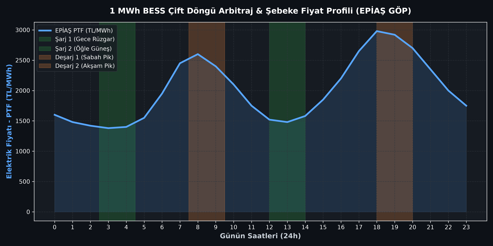
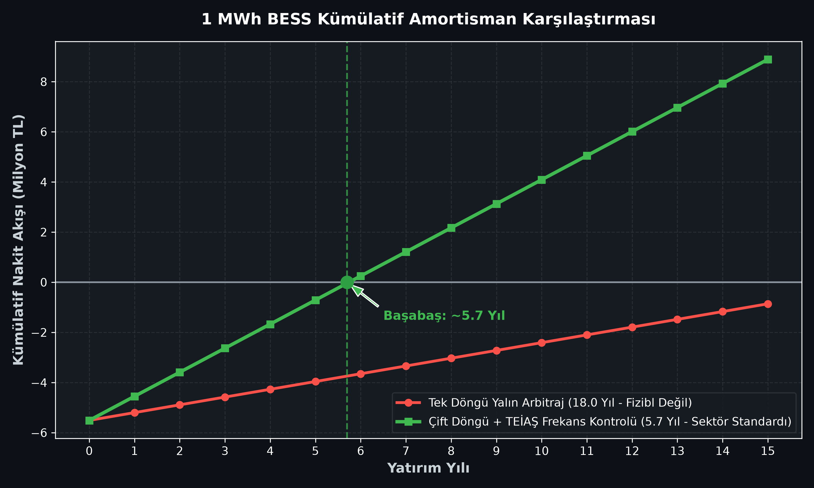

# ⚡ Grid-Scale BESS Techno-Economic & Market Arbitrage Model
> **Case Study:** 1 MWh / 500 kW Containerized LiFePO4 Storage in the Turkish Electricity Market (EPİAŞ Day-Ahead & TEİAŞ Ancillary Services)

[](https://www.python.org/downloads/)
[](https://opensource.org/licenses/MIT)
[]()

---

## 📌 Project Overview
With EPDK's regulation on storage-integrated renewable energy plants (WPP/SPP) in Turkey, **Battery Energy Storage Systems (BESS)** have transitioned from academic curiosity to a multi-billion dollar infrastructure race.

This repository provides an open-source, engineering-first techno-economic model for a **1 MWh / 500 kW (0.5C - 2 Hour)** utility-scale containerized energy storage system operating under **EPİAŞ Day-Ahead Market (GÖP)** price signals and **TEİAŞ Ancillary Services (PFC)**.

### ❓ The Core Problem
Superficial financial models assume a naive **single-cycle energy arbitrage** (charging during the lowest night hour and discharging during the peak evening hour). Due to Round-Trip Efficiency (RTE) losses and battery degradation, this naive model yields an **~18-year payback period (unfeasible)**.

This model demonstrates how advanced **Dual-Cycle Dispatch** combined with **TEİAŞ Primary Frequency Control (PFC) capacity revenue** drops the payback period to **~5.5 years**, making utility-scale storage highly bankable.

---

## 🔋 Technical & Architectural Specifications

| Component / Parameter | Specification | Standard / Engineering Benchmark |
| :--- | :--- | :--- |
| **Cell Chemistry** | Lithium Iron Phosphate ($\text{LiFePO}_4$ - LFP) | CATL EnerC / BYD MC Cube utility container standard |
| **Nominal Energy Capacity** | **1,000 kWh (1 MWh)** | 20-foot outdoor liquid-cooled containerized enclosure |
| **PCS Inverter Rating** | **500 kW (0.5C)** | Bi-directional grid-forming central inverter |
| **Depth of Discharge (DoD)** | **90%** (900 kWh usable) | Preserves cycle life to 6,000+ cycles at 80% SOH |
| **Round-Trip Efficiency (RTE)** | **86.5%** AC-to-AC net | Cell (93%) × Inverter ($97.5\%^2$) × Liquid Cooling Aux (3%) |
| **Turnkey CAPEX** | **$145 / kWh** ($145,000 total) | BNEF 2025/2026 Turnkey Utility Energy Storage Benchmark |
| **Annual O&M (OPEX)** | **1.5% - 1.95%** of CAPEX | Scheduled HVAC servicing, BMS calibration, extended warranty |

---

## 📈 Visualizations & Results

### 1. 24-Hour EPİAŞ Price Spread & Dual-Cycle Dispatch
The model identifies two distinct arbitrage opportunities per day:
- **Cycle 1:** Night wind base surplus (03:00 - 05:00) ➔ Morning commercial ramp (07:30 - 09:30).
- **Cycle 2:** Midday solar photovoltaic peak depression (12:00 - 14:00) ➔ Evening peak demand (18:00 - 20:00).



### 2. Cumulative Cash Flow & Payback Comparison
- **Naive Single-Cycle Arbitrage:** Net annual profit ~0.31M TL ➔ **18.0 Years Payback** (Unfeasible).
- **Dual-Cycle + TEİAŞ Frequency Regulation:** Net annual profit ~0.96M TL ➔ **5.7 Years Payback** (Industry standard bankability).



---

## 🚀 Quickstart & Installation

```bash
# 1. Clone repository
git clone https://github.com/talhacrak01/bess-arbitrage-sim.git
cd bess-arbitrage-sim

# 2. Install dependencies
pip install -r requirements.txt

# 3. Run simulation and generate high-resolution plots
python simulate.py
```

---

## 🔬 Mathematical Formulations

### 1. Net Round-Trip Energy Balance
To deliver usable energy $E_{\text{usable}}$ to the grid, the energy drawn from the grid during charging is:
$$E_{\text{charge}} = \frac{E_{\text{usable}}}{\eta_{\text{RTE}}}$$

Where $\eta_{\text{RTE}} = \eta_{\text{cell}} \times \eta_{\text{PCS,charge}} \times \eta_{\text{PCS,discharge}} \times (1 - \text{Aux}_{\text{cooling}}) \approx 0.865$.

### 2. Simple Payback Period
$$\text{Payback (Years)} = \frac{\text{CAPEX}}{\sum_{d=1}^{350} (\text{Revenue}_{\text{arbitrage}} + \text{Revenue}_{\text{PFC}}) - \text{OPEX}}$$

---

## 👨‍💻 Author
**Talha Çırak**  
*Energy Systems Engineering Student & Researcher*  
- Focus: Grid-Scale BESS, Photovoltaic Systems, Power Electronics & Grid Codes.
- Contact: [@talhacirak_energy](https://instagram.com/talhacirak_energy)
